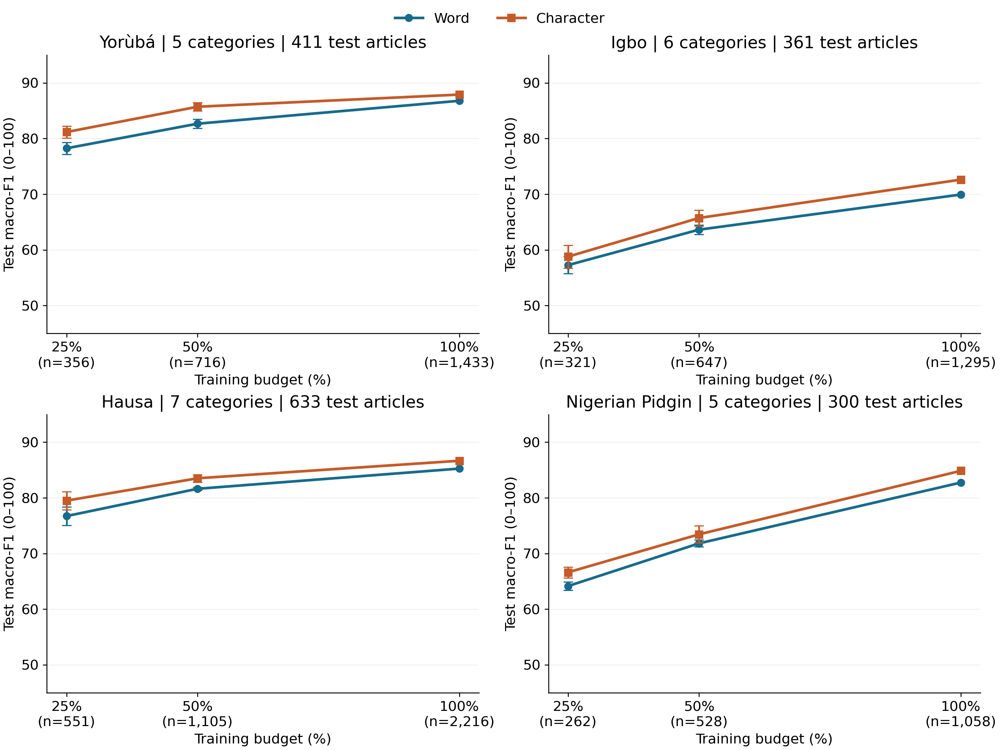

# Learning with Less: Comparing Word and Character Features for News Classification in Four Nigerian Languages

**Author:** Boluwatife Daniel Babalola (Olabisi Onabanjo University)  
**Venue:** IndabaX Nigeria  

  
*(Learning curves comparing Word vs. Character features across 25%, 50%, and 100% training budgets.)*

## Abstract
Does the choice between word and character features matter when labelled news data is limited? We examine this question using MasakhaNEWS article bodies in Yorùbá, Igbo, Hausa, and Nigerian Pidgin.

We compare logistic regression classifiers with word unigram and bigram TF-IDF against character 3-5-gram TF-IDF under fixed settings. Text normalisation and word tokenisation preserve diacritics, and overlapping articles are filtered out prior to training. Both representations use matched training samples at approximately 25%, 50%, and 100% of the retained data.

Both approaches improve as training data increases, but character features achieve higher mean macro-F1 in all twelve language-size comparisons. These exploratory findings support further evaluation of character TF-IDF as a robust baseline for low-resource African language classification.

## Key Results (Full-Data Training)
Character features outscored word features across all 12 evaluated subsets. The table below highlights the macro-F1 (0-100) scores when models were trained on 100% of the available data:

| Language | Word Features | Character Features | Difference |
| :--- | :--- | :--- | :--- |
| **Yorùbá** | 86.79 | 87.90 | +1.11 |
| **Igbo** | 69.94 | 72.63 | +2.68 |
| **Hausa** | 85.26 | 86.67 | +1.41 |
| **Nigerian Pidgin** | 82.75 | 84.86 | +2.11 |

*Note: Differences are calculated before rounding. Pointwise 95% paired Bootstrap intervals (10,000 resamples) for all four full-data comparisons include zero, meaning the full-data advantage remains uncertain and requires further hyperparameter tuning.*

## Repository Structure
*   `poster.pdf` / `abstract.pdf`: Full high-resolution research poster and abstract.
*   `src/`: Python scripts for data loading (`data_utils.py`), modeling (`study_engine.py`), and metric summarization (`summarize_results.py`).
*   `notebooks/`: Jupyter/Colab notebooks for experiment reproduction and bootstrap interval analysis.
*   `languages/`: Per-language outputs including test predictions, classification reports, and confusion matrices.
*   `results/`: Combined analytical summaries and disagreements.

## Reproducibility
The data is sourced from the MasakhaNEWS dataset (Adelani et al., 2023). To reproduce these findings locally or in Google Colab:

1. Clone this repository.
2. Install the required dependencies: `numpy==2.3.5`, `pandas==2.2.3`, `scikit-learn==1.8.0`, and `matplotlib==3.10.8`.
3. Run `python src/run_language.py <language_code>` (e.g., `yor`, `ibo`, `hau`, `pcm`) to execute the models.
4. Run `python src/summarize_results.py` to generate the comparative CSVs and learning curve figures.
5. Execute the `analyse.py` script to generate the pointwise bootstrap intervals and per-class analysis.
